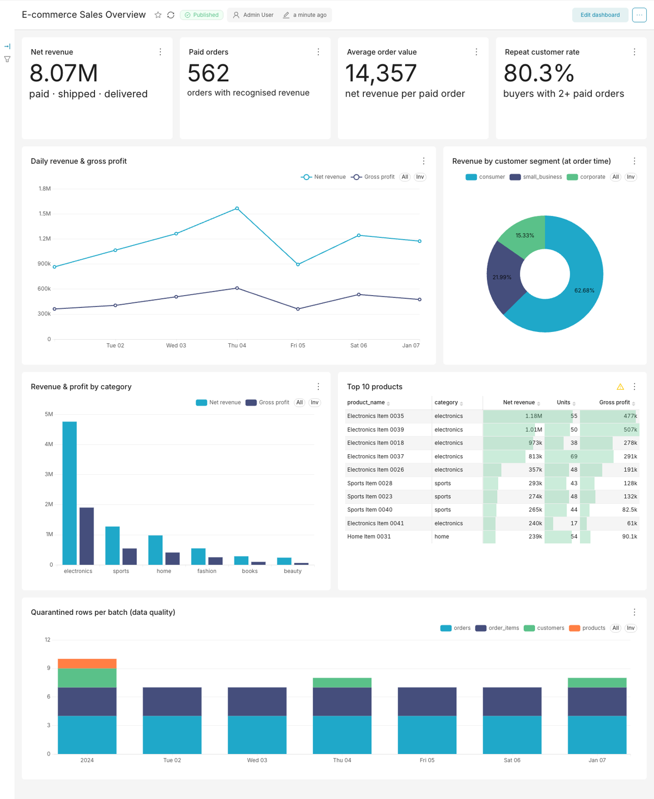

# E-commerce Batch Analytics Platform

使用 **PySpark + Delta Lake + Airflow** 建立可排程、可重跑、可追蹤資料品質的電商批次分析平台。

> 核心問題：如何每天將訂單、商品、客戶資料轉換成可信賴的分析資料，並保留客戶歷史變化，
> 讓分析人員能查詢營收、商品表現及客戶回購行為？

## 架構



<details>
<summary>文字版架構</summary>

```
 Landing CSV (每日增量)                    Apache Airflow  (@daily, {{ ds }}, retries, backfill)
 orders / order_items /                   check_source_files → ingest_bronze → transform_silver
 customers / products                                         → build_gold → validate_outputs
        │                                                │ python -m ecommerce.jobs.<job>
        ▼                                                ▼
 ┌──────────────┐   ┌───────────────────────┐   ┌──────────────────────────────┐
 │   Bronze     │──▶│        Silver         │──▶│             Gold             │
 │ 原始字串+血緣  │   │ 型別/標準化/驗證/去重    │   │ dim_customer (SCD2)          │
 │ replaceWhere │   │ MERGE / replaceWhere  │   │ dim_product  (SCD2 價格歷史)   │
 └──────────────┘   └──────────┬────────────┘   │ fact_sales   (MERGE 增量)     │
                               │                │ agg_daily_sales              │
                     ┌─────────▼────────┐       │ agg_customer_orders (回購)    │
                     │ Quarantine       │       └──────────────┬───────────────┘
                     │ 無效資料+原因     │                      │
                     └──────────────────┘          Trino SQL → Superset 儀表板
            Ops: pipeline_metrics / dq_results / manifests（每次執行的筆數、耗時、失敗原因）
```

</details>

## 專案

| 功能 | 實作方式 | 驗證 |
|---|---|---|
| **冪等性** | Bronze/Quarantine 以 `replaceWhere _batch_date` 覆寫分區；Silver/Gold 用 MERGE；SCD2 用 row hash + 決定性 surrogate key | `test_reruns_are_idempotent_and_backfill_safe`：重跑同一天、或在處理新日期後回補舊日期，Gold 結果完全相同 |
| **增量處理** | 每批只讀當日 Bronze 分區；Gold 只重建「本批次被新增/更新的訂單」，並只重算受影響的日期與客戶 | 舊訂單轉 refunded 時，舊日期的 agg 會被重算（e2e 測試驗證） |
| **SCD Type 2** | 客戶 city/segment、商品 category/成本/售價保留歷史；email/名稱為 SCD1；fact 以下單時間做 point-in-time join | `test_scd2_lifecycle`、`test_fact_revenue_rules_and_point_in_time_dimensions` |
| **資料品質與可觀測性** | 規則化驗證 → quarantine（含原因）；無效比例門檻；輸出驗證 23 項；每個 task/table 記錄輸入/輸出/無效/重複筆數、耗時與錯誤訊息 | `test_quality_gate_blocks_bad_batch` |

## 目錄結構

```
├── dags/ecommerce_daily_pipeline.py      Airflow DAG（5 個可獨立重試的 task）
├── src/ecommerce/
│   ├── config.py / schemas.py            路徑設定、資料契約、商業常數
│   ├── spark_session.py                  Spark + Delta (+ MinIO/S3) session
│   ├── delta_utils.py                    replaceWhere / MERGE 工具
│   ├── quality.py / metrics.py           DQ 規則引擎、執行指標
│   ├── datagen.py                        合成資料產生器（含髒資料、狀態變更、屬性變更）
│   ├── transforms/                       純 DataFrame 邏輯（可單元測試）
│   │   ├── silver.py                     清洗、驗證、去重
│   │   ├── scd2.py                       通用 SCD2 / SCD1
│   │   └── gold.py                       事實表、聚合、營收規則
│   └── jobs/                             Airflow 呼叫的 Spark jobs
│       ├── check_source_files.py  ingest_bronze.py  transform_silver.py
│       ├── build_gold.py  validate_outputs.py
│       └── run_pipeline.py               依序執行 5 個步驟（端到端測試使用）
├── tests/                                單元測試 + 端到端測試
├── analytics/sql/                        Trino 分析查詢（營收、類別、回購、SCD2），可在 SQL Lab 執行
├── trino/                               Trino Delta connector 設定、註冊資料表腳本
├── superset/provision_dashboard.py      以 REST API 建立 Superset 圖表與儀表板
├── docker/superset/                     Superset 映像（加裝 Trino driver）
├── docker/airflow/                       Airflow + Java + PySpark 映像
├── docs/data_model.md                    資料模型、DQ 規則、指標口徑
└── docker-compose.yml / Makefile
```

> 第一次使用？照著 [docs/walkthrough.md](docs/walkthrough.md) 一步一步操作。

## 快速開始（Docker + Airflow）

整個專案都在 Docker 裡執行：Airflow 負責排程，Spark job 在 Airflow 的容器內執行。
本機只需要 **Docker Desktop**（建議分配至少 6 GB 記憶體）。

```bash
make up                                       # 1. 建置映像並啟動 Airflow（第一次約 5–10 分鐘）
                                              #    http://localhost:8080，帳密 airflow / airflow
make data DAYS=7                              # 2. 產生 2024-01-01 ~ 2024-01-07 的 landing CSV
make backfill START=2024-01-01 END=2024-01-07 # 3. 由 Airflow 依序處理 7 天，可在網頁 Grid 頁面觀察
make inspect                                  # 4. 查看各層筆數、每日營收、SCD2 歷史、隔離原因、metrics
make rerun DATE=2024-01-03                    # 5. 重跑某一天 → 結果不變（冪等）
make test                                     # 6. 全部測試（約 6 分鐘；make test-fast 約 1 分鐘）
```

`make up` 會啟動 4 個容器：

| 容器 | 用途 |
|---|---|
| `postgres` | Airflow 的中繼資料庫（DAG 執行紀錄、task 狀態） |
| `airflow-init` | 第一次啟動時建立資料庫與登入帳號，完成後自動結束 |
| `airflow-webserver` | 網頁介面 http://localhost:8080 |
| `airflow-scheduler` | 排程並執行 task；Spark job、測試、`make data`、`make inspect` 都在這個容器內執行 |

映像檔以 `apache/airflow:2.10.5-python3.11` 為基礎，另外安裝 Java 17、PySpark、Delta Lake（見 `docker/airflow/Dockerfile`）。
專案的 `dags/`、`src/`、`scripts/`、`tests/`、`data/`、`logs/` 會掛載進容器，所以修改程式後不用重建映像；
容器產生的資料就在本機的 `data/` 資料夾。

其他指令：

| 指令 | 用途 |
|---|---|
| `make unpause` | 開啟每日自動排程（DAG 預設為暫停） |
| `make logs` | 查看 scheduler 日誌 |
| `make shell` | 進入 scheduler 容器 |
| `make clean` | 刪除處理後的資料（`data/lake`），保留 CSV |
| `make down` | 停止所有容器（保留執行紀錄） |
| `make reset` | 停止並清除 Postgres 中的 Airflow 執行紀錄 |

單獨執行某個 job（和 Airflow task 執行的指令相同）：

```bash
docker compose exec airflow-scheduler python -m ecommerce.jobs.transform_silver --batch-date 2024-01-03 --tables orders,order_items
```

DAG 設計重點：
- 使用 `{{ ds }}`（logical date）決定處理哪一天，不依賴系統時間 → 排程、重跑、回補結果一致。
- `max_active_runs=1`，`build_gold` 設 `depends_on_past=True`，確保 SCD2 依時間順序建立。
- `check_source_files` 重試 6 次、間隔 10 分鐘（等待晚到的檔案）；`transform_silver` 不重試（品質問題不會自己修好）。
- 觸發時可帶參數只重跑部分表：`{"silver_tables": "orders,order_items", "gold_tables": "fact_sales,agg_daily_sales"}`。

## 分析層：Trino + Superset



Gold 表建好之後（例如執行過 `make backfill`），一個指令啟動分析層並建立儀表板：

```bash
make analytics
```

| 服務 | 網址 | 帳密 |
|---|---|---|
| Superset 儀表板 | http://localhost:8088/superset/dashboard/ecommerce-sales/ | admin / admin |
| Trino | http://localhost:8081 | 任意使用者名稱，無密碼 |

`make analytics` 會做三件事：

1. **啟動 Trino 和 Superset**：Trino 直接讀取本機 `data/lake` 的 Delta 表（唯讀掛載），不需要另外搬資料。
2. **在 Trino 註冊資料表**（`trino/register_tables.sh`）：註冊 Gold 5 張表與 ops 2 張執行紀錄表，已註冊的表會略過。
3. **建立 Superset 內容**（`superset/provision_dashboard.py`）：透過 REST API 建立 Trino 連線、資料集、9 張圖表與儀表板。

| 圖表 | 資料來源 | 回答的問題 |
|---|---|---|
| Net revenue / Paid orders / Average order value | agg_daily_sales、fact_sales | 營收、訂單數、平均訂單金額 |
| Repeat customer rate | agg_customer_orders | 有多少買家回購 |
| Daily revenue & gross profit | agg_daily_sales | 每日營收與毛利趨勢 |
| Revenue by customer segment (at order time) | fact_sales | 依「下單當時」的客戶分群（SCD2）看營收 |
| Revenue & profit by category | agg_daily_sales | 哪個類別賺最多 |
| Top 10 products | fact_sales + dim_product | 熱銷商品 |
| Quarantined rows per batch | ops.pipeline_metrics | 每天被隔離的壞資料筆數（資料品質） |

處理新日期後執行 `make analytics-refresh`，就會註冊新的表並重建儀表板（圖表定義寫在程式裡，重跑不會產生重複）。
也可以在 Superset 的 **SQL Lab** 直接查詢，`analytics/sql/` 有現成的分析 SQL。

`make analytics-down` 只停止 Trino 和 Superset；`make down` 會停止所有容器。

**選用：MinIO（S3 相容物件儲存）**：`docker compose --profile minio up -d` 會啟動 MinIO（console :9001）。
若要讓 Spark 改寫到 MinIO，設定 `ECOM_LAKE_ROOT=s3a://lakehouse/lake`、`ECOM_S3_ENDPOINT=http://minio:9000`，
並依 `trino/catalog/delta.properties` 內的註解改用 S3 設定。這條路徑尚未經過完整測試；預設的本機路徑已驗證可用。

## 測試結果

| 測試 | 內容 |
|---|---|
| test_silver.py | 各表驗證規則、標準化、最新版本優先、參照完整性、品質門檻 |
| test_scd2.py | 首次載入、屬性變更產生新版本、重跑無變化、舊資料被忽略、SCD1 覆寫 |
| test_gold.py | 各訂單狀態的營收認列、下單時點成本與客戶分群、每日/客戶聚合 |
| test_pipeline_e2e.py | 3 天 pipeline → 重跑第 3 天 → 回補第 2 天：Gold 完全一致；第 4 天退款重算舊日期；fact 與 agg 營收對帳；壞批次被擋下、修正後重跑成功 |
| test_dag_integrity.py | DAG 可載入、task 順序正確（需在 Airflow 容器內執行） |

指標口徑、退款/取消/折扣處理方式請見 [docs/data_model.md](docs/data_model.md)。
